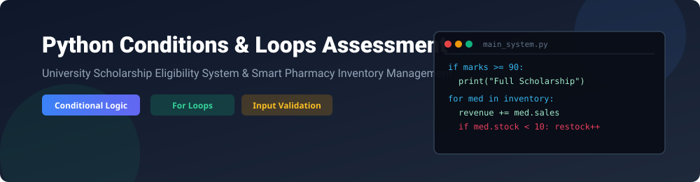
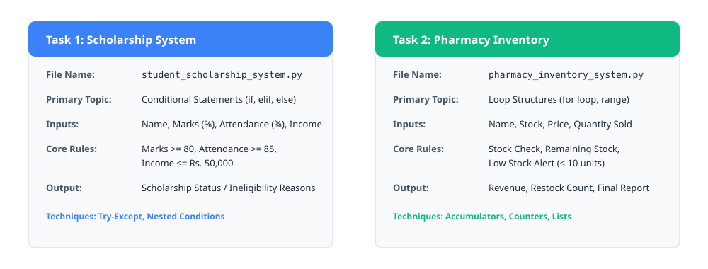
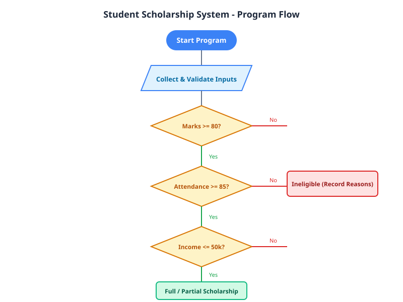
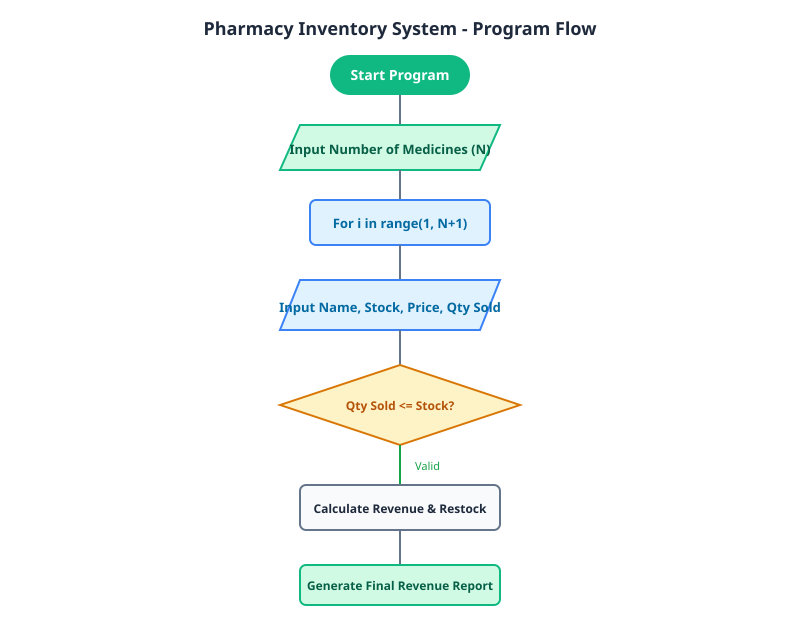
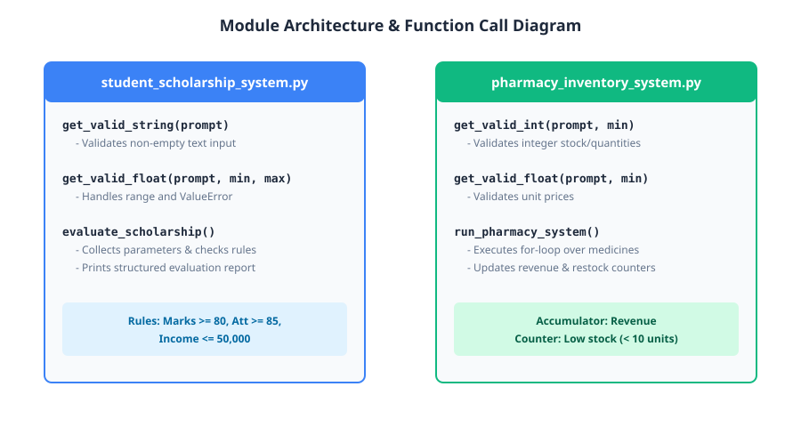

<p align="center"></p>

## 1. Project Overview & Tasks

This repository contains two fully independent Python applications developed for the Conditions and Loops Assessment.

| Task | File Name | Primary Topic | Description |
| :--- | :--- | :--- | :--- |
| **Task 1** | `student_scholarship_system.py` | Conditional Statements (`if`, `elif`, `else`) | Evaluates university scholarship eligibility based on academic marks, attendance percentage, and family income. |
| **Task 2** | `pharmacy_inventory_system.py` | Loop Structures (`for`, `range`, accumulators) | Manages medicine inventory, processes sales, tracks daily revenue, and flags low stock. |

<p align="center"></p>

---

## 2. Folder Structure
```text
python-conditions-loops-assessment/
├── student_scholarship_system.py
├── pharmacy_inventory_system.py
├── README.md
└── assets/
    ├── banner.svg
    ├── overview.svg
    ├── student_scholarship_system_flow.svg
    ├── pharmacy_inventory_system_flow.svg
    └── uml_diagram.svg
```

---

## 3. Program Details & Architecture

### Task 1: Student Scholarship Eligibility System
* **Summary:** Collects student academic data and verifies it against strict university scholarship criteria.
* **Rules & Requirements:**
  * Academic marks must be $\ge 80\%$.
  * Attendance must be $\ge 85\%$.
  * Monthly family income must be $\le 	ext{Rs. } 50,000$.
  * **Tiers:** Marks $\ge 90\%$ qualify for **Full Scholarship**; marks between $80\%$ and $89\%$ qualify for **Partial Scholarship**.
* **Program Flow:**
<p align="center"></p>

#### Code Methods Description
| Method / Section | Purpose |
| :--- | :--- |
| `get_valid_string()` | Ensures user inputs non-empty strings for student name. |
| `get_valid_float()` | Validates numerical inputs within safe bounds ($0 - 100$) and catches `ValueError`. |
| `evaluate_scholarship()` | Core logic evaluating conditional criteria and generating formatted reports. |

---

### Task 2: Smart Pharmacy Inventory & Sales Management System
* **Summary:** Dynamically processes multiple medicines in a pharmacy inventory using `for` loops, tracking stock levels, sales revenues, and low-stock warnings.
* **Rules & Requirements:**
  * Iterates over a user-defined number of medicines using `range()`.
  * Validates that requested sales quantities do not exceed available stock.
  * Accumulates total daily pharmacy revenue.
  * Counts and highlights medicines with remaining stock $< 10$ units.
* **Program Flow:**
<p align="center"></p>

#### Code Methods Description
| Method / Section | Purpose |
| :--- | :--- |
| `get_valid_int()` | Validates integers (quantities, counts) against minimum thresholds. |
| `get_valid_float()` | Validates floating-point numbers (prices, revenue amounts). |
| `run_pharmacy_system()` | Manages loop execution, inventory subtraction, accumulators, and final table generation. |

---

## 4. UML Diagram
The diagram below illustrates the module structure, functions, and data separation between both scripts.

<p align="center"></p>

---

## 5. Python Concepts and Techniques Used
* **Conditional Branching:** `if`, `elif`, and `else` statements for nested and multi-criteria evaluations.
* **Loop Structures:** `for` loops combined with `range()` for iterative data processing.
* **Input Validation:** `try-except` blocks and `while` loops to handle invalid string and numeric inputs gracefully.
* **Accumulators & Counters:** Maintaining running totals for daily revenue and tracking items requiring restocking.
* **Modular Programming:** Clean separation of concerns with dedicated helper functions for inputs and validation.

---

## 6. How to Run

### Prerequisites
* Python 3.x installed on your system.

### Steps
1. Clone the repository:
   ```bash
   git clone https://github.com/ZoradFatima/python-conditions-loops-assessment.git
   cd python-conditions-loops-assessment
   ```
2. Run Task 1 (Student Scholarship System):
   ```bash
   python student_scholarship_system.py
   ```
3. Run Task 2 (Pharmacy Inventory System):
   ```bash
   python pharmacy_inventory_system.py
   ```

---

## 7. Sample Execution

### Task 1 Sample Output (Success Case)
```text
============================================================
      UNIVERSITY SCHOLARSHIP ELIGIBILITY EVALUATION SYSTEM
============================================================
Enter Student's Full Name: Sarah Ahmed
Enter Academic Marks (0 - 100%): 92.5
Enter Attendance Percentage (0 - 100%): 90
Enter Monthly Family Income (Rs.): 42000

------------------------------------------------------------
Evaluating Eligibility Criteria...
------------------------------------------------------------

============================================================
                 SCHOLARSHIP EVALUATION REPORT
============================================================
Student Name            : Sarah Ahmed
Academic Marks          : 92.5%
Attendance Percentage   : 90.0%
Monthly Family Income   : Rs. 42,000.00
------------------------------------------------------------
Status                  : ELIGIBLE FOR SCHOLARSHIP
Scholarship Award       : Full Scholarship (100% Tuition Waiver)
Remarks                 : Congratulations! All criteria successfully met.
============================================================
```

### Task 2 Sample Output (Inventory Processing)
```text
=============================================================
        SMART PHARMACY INVENTORY & SALES MANAGEMENT
=============================================================
Enter the number of different medicines to process: 2

--- Processing Medicine 1 of 2 ---
Enter Medicine Name: Paracetamol 500mg
Enter Available Stock (units): 50
Enter Price per Unit (Rs.): 5.50
Enter Quantity Sold: 45

[Transaction Receipt: Paracetamol 500mg]
  - Units Sold     : 45
  - Revenue Generated: Rs. 247.50
  - Remaining Stock  : 5 units
  *** WARNING: Low stock (< 10 units remaining)! Restocking required. ***

--- Processing Medicine 2 of 2 ---
Enter Medicine Name: Amoxicillin 250mg
Enter Available Stock (units): 100
Enter Price per Unit (Rs.): 25.00
Enter Quantity Sold: 20

[Transaction Receipt: Amoxicillin 250mg]
  - Units Sold     : 20
  - Revenue Generated: Rs. 500.00
  - Remaining Stock  : 80 units

=============================================================
                 PHARMACY DAILY OPERATIONS FINAL REPORT
=============================================================
Total Medicines Processed    : 2
Total Pharmacy Revenue       : Rs. 747.50
Medicines Requiring Restock  : 1
-------------------------------------------------------------
Medicine Name        | Sold   | Remaining  | Revenue (Rs.) | Status
-------------------------------------------------------------
Paracetamol 500mg    | 45     | 5          |       247.50  | RESTOCK
Amoxicillin 250mg    | 20     | 80         |       500.00  | OK
=============================================================
```

---

## 8. Test Cases

### Task 1 Test Cases
| # | Scenario | Inputs (Marks, Attendance, Income) | Expected Result | Actual Result |
| :-: | :--- | :--- | :--- | :--- |
| 1 | Full Scholarship | $92.5, 90\%, 	ext{Rs. } 42,000$ | Eligible (Full Scholarship) | Passed |
| 2 | Partial Scholarship | $84.0, 88\%, 	ext{Rs. } 35,000$ | Eligible (Partial Scholarship) | Passed |
| 3 | Low Marks Rejection | $75.0, 90\%, 	ext{Rs. } 30,000$ | Not Eligible (Marks below 80%) | Passed |
| 4 | High Income Rejection | $88.0, 92\%, 	ext{Rs. } 60,000$ | Not Eligible (Income exceeds limit) | Passed |

### Task 2 Test Cases
| # | Scenario | Inputs / Operations | Expected Result | Actual Result |
| :-: | :--- | :--- | :--- | :--- |
| 1 | Normal Sale & Stock OK | Stock: 100, Sold: 20, Price: 25 | Rev: 500, Rem: 80, Status: OK | Passed |
| 2 | Low Stock Trigger | Stock: 50, Sold: 45, Price: 5.5 | Rev: 247.5, Rem: 5, Restock Flag | Passed |
| 3 | Invalid Stock Request | Stock: 20, Sold: 30 | Rejects sale & prompts again | Passed |

---
**Author:** Zorad Fatima
